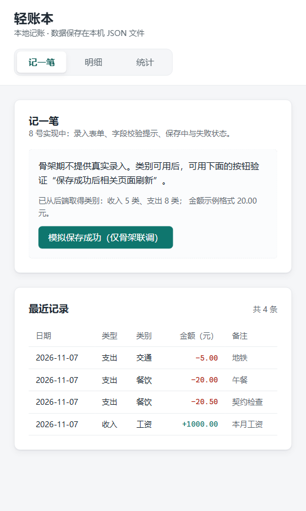
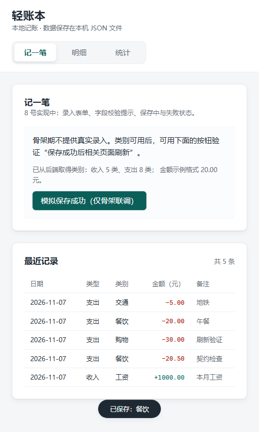
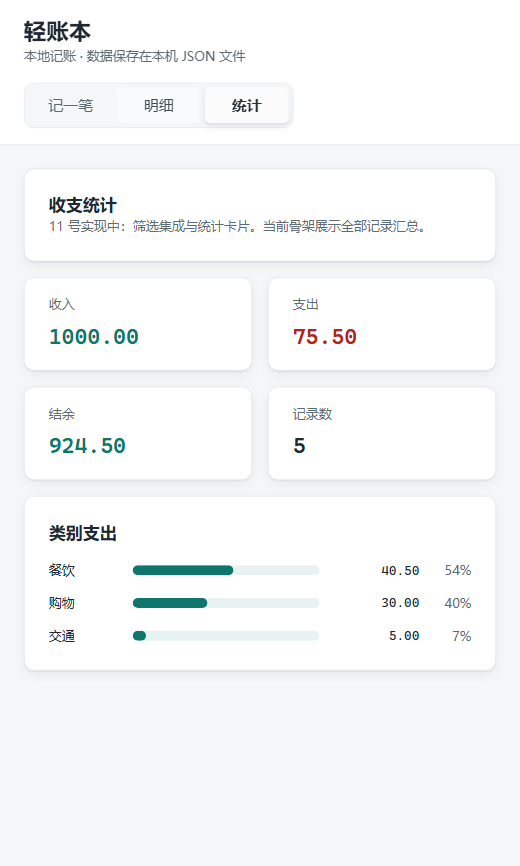
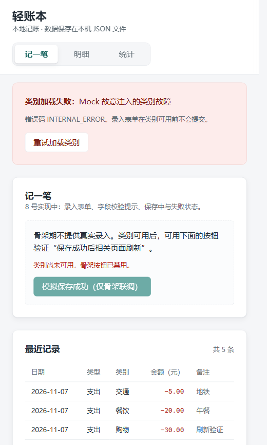
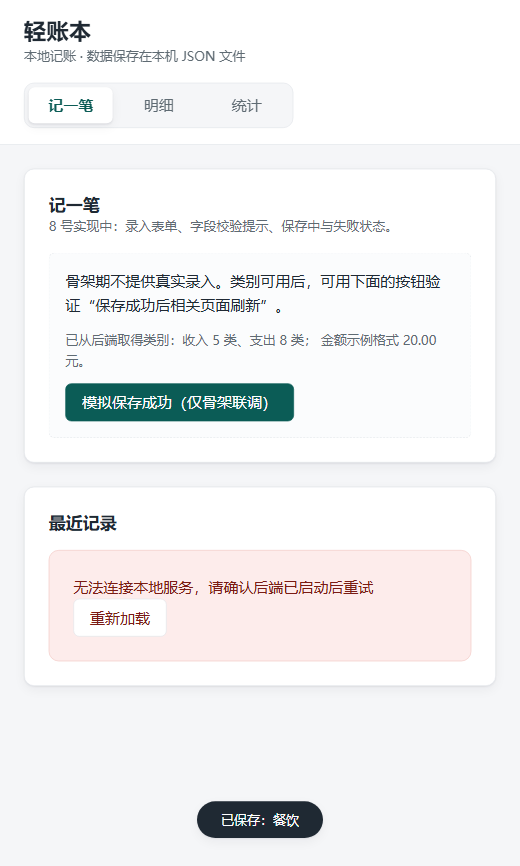

# 7 号模块交付说明：前端框架与整合（郑志銮）

> 依据：仓库 `docs/项目设计与协作规范.md`（第 4、9、10、12 节）。
> 本说明对应分支 `feat/07-frontend-shell`，只覆盖 7 号负责的前端框架与整合部分。
> 交付目录：仓库 `frontend/`（另有 `devmock/` 开发期联调工具，不入 Release）。

## 1. 当前状态

合并整合说明：同名记录展示占位组件已由 9 号 PR #5 正式组件替换，保留请求竞态、卸载保护和重试逻辑。7 号原始独立验证记录按历史状态保留；完整应用与 Release 仍待后端装配及其他页面正式模块就绪。

已完成并可运行：

- Vue 3 + Vite 工程：`package.json`、`package-lock.json`（lockfileVersion 3）、`vite.config.js`、`index.html`、`main.js`。
- 三页导航（记一笔 / 明细 / 统计），本地状态切换，`v-if` 挂载，无路由库。
- 统一 API 客户端 `src/api/client.js`：四个方法、参数白名单、`ApiError`、网络错误码 `NETWORK_ERROR`。
- 公共样式 `src/styles/base.css`（颜色、间距、圆角、状态块、表格与按钮基线）。
- 公共格式化 `src/utils/format.js`（整数分格式化、收支符号、本地日期）。
- 类别加载：挂载时请求 `GET /api/categories`；失败显示错误码 + 重试按钮，且不使用前端写死的备用类别。
- 刷新协调：`saved` → `refreshKey + 1` → 已挂载的最近记录重新请求；失败不递增。
- 记账页组合 `EntryView.vue`：只组合，不代写子组件。

尚未完成（不属于 7 号）：

- 8/10/11 号的组件目前是**占位外壳**（见第 3 节），必须由对应负责人替换为真实实现。
- 真实 Flask 后端接入：等 1 号的应用工厂与接口就绪后，把 `vite.config.js` 的代理目标改为实际端口，并把 `frontend/dist` 复制到 `web/`。

## 2. 文件归属与状态

| 文件 | 归属 | 状态 |
| --- | --- | --- |
| `frontend/package.json` | 7 | 完成 |
| `frontend/package-lock.json` | 7 | 完成（npm install 生成） |
| `frontend/vite.config.js` | 7 | 完成（`/api` 代理、`base './'`） |
| `frontend/index.html` | 7 | 完成 |
| `frontend/src/main.js` | 7 | 完成 |
| `frontend/src/App.vue` | 7 | 完成（导航 + 类别 + 刷新协调） |
| `frontend/src/api/client.js` | 7 | 完成 |
| `frontend/src/styles/base.css` | 7 | 完成 |
| `frontend/src/utils/format.js` | 7 | 完成 |
| `frontend/src/views/EntryView.vue` | 7 | 完成（仅组合） |
| `frontend/scripts/check-format.mjs` | 7 | 完成（`npm run check` 自检） |
| `frontend/src/components/entry/RecordForm.vue` | 8 | **占位**，待 8 号替换 |
| `frontend/src/components/records/RecordTable.vue` | 9 | 已接入 PR #5 的正式实现 |
| `frontend/src/components/records/RecentRecords.vue` | 9 | 已接入 PR #5 的正式实现 |
| `frontend/src/components/filters/FilterPanel.vue` | 10 | **占位**，待 10 号替换 |
| `frontend/src/views/RecordsView.vue` | 10 | **占位**，待 10 号替换 |
| `frontend/src/components/statistics/CategoryChart.vue` | 11 | **占位**，待 11 号替换 |
| `frontend/src/views/StatisticsView.vue` | 11 | **占位**，待 11 号替换 |
| `devmock/mock_server.py` | 7（开发工具） | 完成，仅联调用，不入 Release |
| `devmock/check_contract.py` | 7（开发工具） | 完成，接口契约自检 |

占位文件的头部注释已写明“归属谁、交付前必须替换、哪些契约不能变”，不会被误当成正式实现。

## 3. 公开接口（其他成员直接依赖）

### 3.1 `src/api/client.js`

| 导出 | 签名 | 说明 |
| --- | --- | --- |
| `getCategories()` | `() => Promise<{income: string[], expense: string[]}>` | 类别由 6 号接口提供，前端不写死 |
| `createRecord(payload)` | `({date, type, amount, category, note?}) => Promise<Record>` | 只提交 5 个允许字段；`amount` 必须是字符串；POST 不重试 |
| `listRecords(params)` | `({start_date,end_date,type,category,min_amount,max_amount,limit,offset}) => Promise<{items,total,limit,offset}>` | 只发送白名单参数 |
| `getStatistics(filters)` | `(六个业务条件) => Promise<Statistics>` | 自动剔除 `limit/offset`，统计对象是全部匹配记录 |
| `ApiError` | `class` | 字段：`code`、`message`、`fields`、`status`（网络错误 `status=0`） |
| `isApiError(error)` | `(error) => boolean` | 供组件区分请求失败与其他异常 |
| `API_BASE` | `string` | 默认 `/api`，可用 `VITE_API_BASE` 覆盖 |

参数规则（实现细节，页面必须遵守）：

- 空参数、`undefined`、`null`、空字符串**不发送**；`0` 与 `"0"` 原样发送（金额边界 0 是合法值）。
- 成功只返回响应体里的 `data`，页面不再取第二层。
- 非 2xx 抛 `ApiError`，`files/fields` 原样带出，供表单定位字段错误。
- 成功状态码但响应不是 `{data:...}` 结构时抛 `INVALID_RESPONSE`，不当成正常数据。
- `fetch` 抛错（服务未启动、连接被拒）统一转成 `NETWORK_ERROR`。

### 3.2 `src/utils/format.js`

| 导出 | 说明 |
| --- | --- |
| `formatMoney(cents)` | 整数分 → `"1000.00"`；负数保留 `-`；非整数分抛 `TypeError`（不悄悄四舍五入） |
| `formatSignedMoney(type, cents)` | 收入 `"+1000.00"`，支出 `"-20.00"`；颜色由界面决定 |
| `todayLocalISO(now?)` | 浏览器本地 `YYYY-MM-DD`，不用 `toISOString()` 截取（避免东八区凌晨显示成前一天） |
| `formatDate(isoDate)` | 日期显示统一入口 |

### 3.3 `App.vue` 与 `EntryView.vue`

- `App.vue` 内部状态：`activePage`、`refreshKey`、`categories`、`categoriesLoading`、`categoriesError`。
- `EntryView` props：`categories`、`refreshKey`；事件：`saved(record)` 原样向 App 转发。
- `refreshKey` 语义：**只增不减**，仅在保存成功后 `+1`；子组件用 `watch(refreshKey, ..., {immediate: true})` 首次请求并响应刷新。
- `categories` 形状与 `GET /api/categories` 的 `data` 完全一致；为 `null` 表示不可用，表单不得提交。

## 4. 依赖关系

| 方向 | 对象 | 说明 |
| --- | --- | --- |
| 我依赖 | 6 号 `GET /api/categories` | 类别的唯一来源 |
| 我依赖 | 3/4/5 号 `POST /api/records`、`GET /api/records`、`GET /api/statistics` | 通过 `client.js` 调用 |
| 我依赖 | 1 号静态资源与错误响应格式 | 交付版由 Flask 提供 `web/`，未知 API 返回 JSON 404 |
| 依赖我 | 8 号 `RecordForm` | 用 `props.categories`，`emit('saved', record)` |
| 依赖我 | 9 号 `RecordTable` / `RecentRecords` | `listRecords` 已封装；`refreshKey` 触发刷新 |
| 依赖我 | 10 号 `FilterPanel` / `RecordsView` | `listRecords` 的参数白名单与 `refreshKey` |
| 依赖我 | 11 号 `StatisticsView` / `CategoryChart` | `getStatistics` 与 `formatMoney` |

## 5. 环境版本（README 2.1 要求记录）

| 项 | 实际验证版本 |
| --- | --- |
| Node.js | v22.23.2 |
| npm | 10.9.8 |
| vue | 3.5.45 |
| vite | 7.3.7 |
| @vitejs/plugin-vue | 6.0.10 |
| 锁文件 | `package-lock.json`，lockfileVersion 3 |

其他成员拿到仓库后执行 `npm ci`，不要各自升级到 latest。

## 6. 如何运行与验证

### 6.1 命令

```powershell
cd frontend
npm ci                 # 或首次 npm install
npm run dev            # 开发：http://127.0.0.1:5173，/api 代理到 http://127.0.0.1:5000
npm run build          # 构建产物 frontend/dist
npm run check          # 公共格式化自检，不依赖浏览器与后端
```

换代理端口（例如先接 Mock）：

```powershell
$env:VITE_API_PROXY_TARGET = "http://127.0.0.1:5055"; npm run dev
```

### 6.2 开发期联调（真实后端未就绪时）

```powershell
# 在仓库根目录执行
python devmock/mock_server.py --web frontend/dist --port 5055
python devmock/check_contract.py --base http://127.0.0.1:5055
```

`devmock` 只用 Python 标准库，数据在内存里，进程结束即丢失，**不进入 Release 运行包**，也不替代 1/3/4/5/6 号的实现。

### 6.3 实际验证结果（本次真实执行）

| 验证项 | 方法 | 结果 |
| --- | --- | --- |
| 生产构建 | `npm run build` | 通过：30 modules，`dist/index.html` + JS 78.70 kB + CSS 7.78 kB |
| 资源路径 | 检查 `dist/index.html` | 使用 `./assets/...` 相对路径，Flask 根路径与子路径都不会 404 |
| 格式化自检 | `npm run check` | 20/20 通过（含 0.10+0.20 显示为 0.30、负结余、上限、非整数分抛错、本地日期） |
| 接口契约 | `python devmock/check_contract.py` | 57/57 通过（三类基准数据、筛选餐饮、金额字符串校验、分页、404/405/415） |
| 三页导航 | 浏览器点击“记一笔/明细/统计” | 三页均正常渲染，切换后页面数据重新请求 |
| 保存后刷新 | 页面显示“共 4 条”→ 外部新增 1 条 → 点保存占位按钮 | 变为“共 5 条”，新记录 `购物 -30.00` 出现，出现“已保存：餐饮”提示，网络记录出现新的 `GET /api/records?limit=10` |
| 类别失败态 | Mock 注入 `categories` 500 后刷新 | 显示“类别加载失败：… 错误码 INTERNAL_ERROR”，提供“重试加载类别”，保存按钮被禁用 |
| 失败恢复 | 关闭注入后点“重试加载类别” | 错误条消失，类别恢复为收入 5 类 / 支出 8 类 |
| 网络错误态 | 停掉 Mock 后触发刷新 | 显示“无法连接本地服务，请确认后端已启动后重试”+“重新加载”，未显示成“暂无数据” |
| 统计一致性 | 统计页读数 | 收入 1000.00、支出 75.50、结余 924.50、5 条；类别 40.50+30.00+5.00=75.50，与总支出一致 |

截图在 `docs/assets/`：

| 文件 | 内容 |
| --- | --- |
| `01-entry-page.png` | 记一笔页（三页导航、类别加载成功、最近记录） |
| `02-after-saved-refresh.png` | 保存后刷新：共 5 条、新记录出现、保存提示 |
| `03-records-page.png` | 明细页（筛选面板 + 记录列表） |
| `04-statistics-page.png` | 统计页（四张统计卡 + 类别条形图） |
| `05-categories-error.png` | 类别加载失败 + 重试入口 |
| `06-retry-recovered.png` | 重试后恢复 |
| `07-network-error.png` | 后端未启动时的网络错误提示 |











浏览器环境说明：以上交互在豆包内置浏览器（Chromium 内核，视口 520×866）实测；未在 Firefox/Safari 实测，也未做真机移动端测试。

## 7. 关键设计说明（演示/老师追问用）

1. **类别为什么不在前端写死**：类别只在 6 号 `categories.py` 定义，页面通过接口获取。新增“宠物”这类固定类别时只改后端，前端下拉自动出现。
2. **金额为什么只做格式化**：存储、筛选、统计全用整数分；前端 `formatMoney` 用整数取整除法拼字符串，不经过浮点乘法，所以 0.10+0.20 显示 0.30 不会出现 `0.30000000000000004`。录入金额保持字符串交给后端 `Decimal`。
3. **为什么用 `refreshKey` 而不是 `location.reload`**：整页重载会丢失当前页面与已填内容；`refreshKey` 是单向递增的“数据已变化”信号，只有保存成功才递增，失败不刷新。跨页面不直接调用别人的内部方法，符合 README 9.3。
4. **为什么三页用 `v-if` 而不是路由**：首版约定不引入路由库；重新进入页面即重新请求、筛选默认重置，正好符合 9.1。
5. **为什么构建用 `base: './'`**：交付版由 Flask 在站点根路径提供 `web/`，相对基址可避免部署位置变化时静态资源 404。
6. **请求竞态**：`RecentRecords`、占位明细/统计都用 `requestSeq` 只认最后一次响应。正式实现由 10 号按同样思路扩展（快速查询取最后一次）。

## 8. 已知限制

- 首版不保留筛选状态：切到其他页再回来，筛选条件会重置（README 9.1 明确为首版行为，需要保留时另立交互变更）。
- 占位组件功能有限：记账表单不能真实录入，筛选面板只发空条件，明细分页未做；这些是 8/9/10/11 号的工作，不是本模块“已完成”的一部分。
- `client.js` 未加超时/取消：网络挂起时靠 `requestSeq` 丢弃过期结果，但没有 `AbortController` 中断请求；GET 也不自动重试。
- 类别加载失败时录入被禁用（有意设计，避免用写死类别提交）；恢复依赖用户点重试。
- 只做了窄屏单列适配（860px 断点），未做完整移动端交互优化。
- 演示数据中的 `created_at` 由 Mock 固定生成，仅用于界面展示，不代表真实时区处理结果。

## 9. Git 与协作步骤

本次前端骨架已提交到分支 `feat/07-frontend-shell`（提交信息见仓库记录），下面是后续维护时继续使用的流程。

1. 从 1 号建好的仓库拉取 `main`，建自己的分支：

```powershell
git switch main
git pull --ff-only origin main
git switch -c feat/07-frontend-shell
```

2. 本分支已包含 `frontend/`、`devmock/`、`docs/` 下对应文件（**不含** `node_modules`、`dist`）。
3. 已确认仓库 `.gitignore` 包含：`node_modules/`、`/frontend/dist/`、`/web/`、`/data/`、`.venv/`、`__pycache__/`。
4. 提交前只暂存自己的文件：

```powershell
git status
git add frontend devmock docs
git commit -m "feat(frontend): 搭建 Vue/Vite 骨架、统一 API 客户端与刷新协调"
```

5. PR 模板按 README 12.3 填写，本模块建议内容：

```markdown
关联 Issue：#7
负责模块：前端框架与整合（7 号 郑志銮）
实现内容：Vue/Vite 工程与锁文件、三页导航、api/client.js（四方法 + ApiError）、
  公共样式与格式化、类别加载与失败重试、saved→refreshKey 刷新协调、EntryView 组合。
公开接口/数据结构是否变化：新增 src/api/client.js 四个方法与 ApiError；新增
  formatMoney/formatSignedMoney/todayLocalISO；刷新约定 refreshKey 只增不减。
验证方法与实际结果：npm run build 通过（30 modules）；npm run check 20/20；
  python devmock/check_contract.py 57/57；浏览器三页 + 保存后刷新 + 类别失败重试 +
  网络错误态均实测通过（截图 docs/assets/01—07）。
界面截图：docs/assets/01-entry-page.png、02-after-saved-refresh.png、04-statistics-page.png
已知限制：占位组件待 8/9/10/11 号替换；筛选状态不保留；client 无超时与取消；
  未在 Firefox/Safari 实测。
```

## 10. 需要其他成员配合的事项

- **8 号**：替换 `RecordForm.vue`；必须使用 `props.categories`，金额保持字符串，保存中禁用按钮，成功 `emit('saved', record)`，失败保留输入。
- **9 号**：替换 `RecordTable.vue`、`RecentRecords.vue`；`RecordTable` 只接收 `records`、不发请求；备注只用文本插值，禁止 `v-html`。
- **10 号**：替换 `FilterPanel.vue`、`RecordsView.vue`；`filters` 用 HTTP 参数名、金额字符串、空项省略；改 type 后清空不匹配的类别；快速查询只认最后一次响应。
- **11 号**：替换 `StatisticsView.vue`、`CategoryChart.vue`；只展示后端统计结果，`totalCents=0` 时显示空态。
- **1 号**：接好真实后端后核对 `/api` 代理端口、`web/` 与构建产物同版本；`.gitignore` 补前端忽略项。
- 任何人修改 `package.json`、锁文件、`vite.config.js`、`base.css` 变量前先找我（README 11.1 约定）。

## 11. 演示与博客可用材料

演示动作（17:00—17:15 可用）：切三页 → 点“模拟保存成功”（或换成 8 号真实表单）观察最近记录刷新 → 停服务看错误态 → 说明金额整数分与类别来源。

真实发生的问题与处理（可直接写进博客“问题—处理—收获”）：

1. **用 PowerShell 的 curl 传中文查询参数时，`category=餐饮` 被当成未知类别返回 400**。改用 Python `urllib.parse.urlencode` 的检查脚本后，同样的筛选返回正确的 0/2000/-2000/1。收获：接口验证不能依赖某个 shell 的编码行为，要用可控的客户端；也说明这类 400 可能来自参数编码而不是业务逻辑。
2. **想写一个 Node 端的 API 客户端自检脚本，但 `client.js` 依赖 `import.meta.env`，Node 下没有这个对象**。改为在浏览器里实测三页与错误态，客户端契约单独用 Python 对照 Mock 验证。收获：验证工具要按运行环境选，不能为了“自动化”写一个跑不起来的脚本。
3. **占位组件与“不代写别人模块”的边界冲突**：骨架需要可运行才能验证刷新链路。做法是占位外壳里只保留“发出 `saved`”的按钮，用外部新增一条记录再点按钮，证明 `refreshKey` 真的触发了重新请求，而不是只写了个假页面。收获：可以用最小的联调外壳验证自己的集成契约，同时不侵占别人模块。
4. **`vite build` 默认资源路径在 Flask 子路径下会 404**。改为 `base: './'` 后，`dist/index.html` 引用 `./assets/...`，根路径与子路径都能加载。收获：交付模式（Flask 托管）与开发模式（Vite 代理）的路径假设不同，构建配置要按交付形态定。

## 12. 我讲不清就不算完成的部分（自查）

- `refreshKey` 为什么能替代整页刷新、失败为什么不刷新：见 7.3，可在 `App.vue` 的 `handleSaved` 与 `RecentRecords` 的 `watch` 现场指认。
- 金额为什么不用浮点：见 `formatMoney` 实现与 `npm run check` 的 0.10/0.20/0.30 用例。
- 类别失败为何禁用录入：见 `App.vue` 的 `loadCategories` 与占位表单的 `canEmit`。
