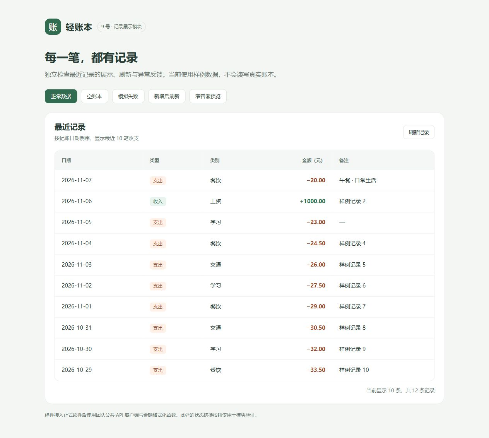

# 9 号龚巍斌：记录展示模块

## 1. 实现范围

在本地 `09` 分支实现以下两个真实 Vue 单文件组件，遵循团队的 Vue 3、统一 API 客户端和整数分金额契约。

| 文件 | 职责 |
| --- | --- |
| frontend/src/components/records/RecordTable.vue | 展示记录，支持复用、空态文本和行操作插槽 |
| frontend/src/components/records/RecentRecords.vue | 请求最近十条、刷新、加载/空态/失败、重试与竞态保护 |
| tests/frontend/records/ | 独立编译、DOM 测试和浏览器预览，不改变正式前端框架 |

当前实现与独立验证已完成。真实查询接口、公共 API 客户端、公共格式化和页面装配仍由 4、7 号提供，完整应用联调尚未完成，不能将样例预览当作端到端验收。

## 2. 给 7 号与 10 号的接入说明

### RecordTable

```vue
<script setup>
import RecordTable from '../components/records/RecordTable.vue'

defineProps({ items: { type: Array, default: () => [] } })
</script>

<template>
  <RecordTable :records="items" empty-text="没有匹配的记录" />
</template>
```

| 参数 | 类型 | 默认值 | 约定 |
| --- | --- | --- | --- |
| records | Array | [] | 使用 API 返回顺序，不在组件中排序或分页 |
| emptyText | String | 暂无记账记录 | 可选，明细页可以设置为无匹配提示 |
| actions 插槽 | 接收 { record } | 无 | 可选，存在时自动增加操作列 |

记录字段为 id、date、type、amount_cents、category、note；created_at 可以传入但不展示。输入采用团队后端已校验的数据。组件不请求网络、不修改 Props、不重新计算收支汇总。

金额调用 7 号 `src/utils/format.js` 的命名导出 `formatMoney(cents)`，约定返回 `20.00` 这样的两位小数字符串，**不包含货币符号或正负号**。本组件添加收入 `+`、支出 `−`，列标题说明单位为元。

备注使用文本插值，HTML 不会执行；空备注显示破折号。长备注换行，窄容器在表格内部横向滚动。组件样式 scoped，公共颜色可以通过 CSS 变量覆盖。

### RecentRecords

在 EntryView 中导入并放入页面：

```vue
<script setup>
import RecentRecords from '../components/records/RecentRecords.vue'

defineProps({ refreshKey: { type: [Number, String], default: 0 } })
</script>

<template>
  <RecentRecords :refresh-key="refreshKey" />
</template>
```

父页面在新增持久化成功后增加 refreshKey。首次挂载以及该值改变都会重新请求。也支持用户点击“刷新记录”或错误状态下的“重试”。

依赖 7 号 `src/api/client.js` 的命名导出：

```text
listRecords({ limit: 10, offset: 0 })
  -> Promise<{ items: Record[], total: number, limit: number, offset: number }>
```

客户端成功时已经解包 data，失败时抛出包含 message 的 ApiError。组件不会直接 fetch，也不接受外层仍包着 data 的响应。若 items 或 total 违反契约，会显示可重试的错误。

日期倒序由 4 号查询模块负责，组件保留后端顺序。最近十条按照业务日期排序，不等同于“最近创建的十条”；保存一条较早日期的记录，不保证它排在第一行。

## 3. 核心业务注释与状态处理

两个组件头部均注释职责、输入和依赖。RecentRecords 的 loadRecords 是核心业务处理，代码中详细说明：

1. 每次请求递增 latestRequestId。
2. 成功、失败、finally 都检查请求序号；过时请求不能覆盖记录、错误或 loading。
3. 开始加载时清除旧错误；加载、失败、空账本和成功使用不同界面分支。
4. 失败时不把旧记录继续显示为最新结果，不把故障伪装成空列表。
5. 卸载时使已有请求失效，避免离开页面后迟到的响应继续提交状态。

此方式不要求 7 号客户端额外接受 AbortSignal，也不会破坏既定接口。它丢弃过时结果，但不取消已发出的请求；以后需要节省网络开销时，再协同增加取消能力。

## 4. 维护与后续增加功能

| 需求 | 修改方式 |
| --- | --- |
| 明细页复用表格 | 10 号传入 items 和 emptyText，分页与筛选仍在明细页面 |
| 增加支付方式列 | 先约定后端字段与旧数据默认值，再在表格增加标题和单元格 |
| 添加编辑/删除按钮 | 父页面通过 actions 插槽提供按钮并处理事件，表格不耦合具体写入接口 |
| 调整显示数量 | 同步修改请求 limit、界面说明和对应验证，仍由后端执行排序 |
| 修改金额展示风格 | 先协调 7 号公共 formatMoney 契约，避免产生两套金额处理 |
| 显示更多记录 | 使用明细页分页，不把最近记录组件改成全量账本 |

行操作插槽示意，openEdit 由后续父页面负责实现：

```vue
<RecordTable :records="items">
  <template #actions="{ record }">
    <button type="button" @click="openEdit(record)">编辑</button>
  </template>
</RecordTable>
```

## 5. 实际验证

验证环境：Node.js v24.16.0、npm 11.13.0、Vue 与 compiler-sfc 3.5.45、jsdom 31.0.0。

依赖固定在独立验证目录，未修改 7 号的 frontend/package.json，也没有创建假生产客户端。编译缓存位于该目录 node_modules 内，不提交 Git。

```powershell
cd tests/frontend/records
npm ci
npm test
npm run preview
```

测试使用真实 Vue 编译和 DOM 挂载，14 项已通过：

- 日期、类型、类别、正负金额、空备注和接口顺序。
- 冻结 Props 不被修改，恶意 HTML 备注不生成可执行元素。
- 自定义空态、actions 插槽与 Props 更新。
- 首次请求明确 limit=10、offset=0；加载不误报空账本。
- 成功空列表与请求失败有不同状态。
- 失败提示和重试恢复。
- 晚到的旧成功不能覆盖新结果。
- 旧请求不能提前关闭新请求 loading。
- 旧失败不能覆盖新成功。
- 刷新失败不会留下被误认作最新结果的旧表格。
- 未解包或格式错误的响应不会被静默忽略。
- 卸载后完成的请求不会恢复界面。
- 浏览器解析后的预览模板能够实际挂载组件，防止空白预览回归。

浏览器预览已检查正常十条展示、空账本、错误提示、新增后 refreshKey 刷新，以及窄容器内横向滚动。预览页仅提供内存样例，不读写真实账本；不应复制其样例接口到正式程序。



## 6. 仓库协作流程与 PR 时机

本次已克隆并阅读团队仓库，对齐的 main 基线为 `339d97c`。该基线包含项目骨架、6 号实现及软件 README 整理；未合并其他成员尚在开发的功能分支。

远端现有提交显示，6 号功能通过 PR #1、软件介绍通过 PR #3 合入 main，并保留 merge commit。完整约定为：

```text
基于 main 建立个人分支
→ 在个人分支实现并形成规范 commit
→ 自测并记录结果
→ 推送个人分支
→ 创建个人分支到 main 的 PR
→ 另一位成员复审
→ 修复并继续提交到同一 PR
→ 由整合人使用 merge commit 合并
```

本人按要求使用名为 `09` 的分支，不直接在 main 提交。当前只有本地提交，未推送、未创建 PR。

一个模块通常对应一个 PR，可以包含多次 commit，不需要每次 commit 都创建 PR。功能和验证完成、准备交给队友集成时创建正式 PR；需要提前讨论接口或展示未完成进展时，可以创建 Draft PR。

只有本地 commit 不会自动出现在 GitHub，正式创建 PR 前需要推送 09。推送、PR 创建和合并是三个不同动作，应分别核对目标分支。

## 7. 待用 PR 描述

以下是准备好的描述，不代表已经创建 PR。真实 Issue 编号、复审人和完整联调结果由团队后续补充。

```markdown
标题：feat(records): 完成9号记录展示与最近记录刷新

Base：main
Compare：09
负责人：9号 龚巍斌
关联 Issue：待填写真实编号

完成内容：
- 实现可复用 RecordTable，展示日期、收支类型、类别、金额和备注。
- 实现 RecentRecords，获取最近十条并处理刷新、加载、空态、错误与重试。
- 增加请求序号和卸载失效保护，防止旧响应覆盖新结果。
- 添加详细模块和核心逻辑注释，以及独立测试/预览和接入说明。
- 按要求分离软件 README 与项目分工总览，保留旧技术文档链接入口。

验证：
- 14项真实组件DOM测试通过。
- 浏览器检查正常数据、空态、错误、新增后刷新及窄容器滚动。
- 预览截图见模块交接文档。

接口影响：
- 保持 records、refreshKey、listRecords 与 formatMoney 既定契约。
- RecordTable 新增可选 emptyText 与 actions 插槽，不影响原调用。

依赖与限制：
- 待4号查询接口、7号公共客户端/格式化与页面装配后完成真实联调。
- 独立预览使用样例接口，未声明完整软件验收通过。
```
