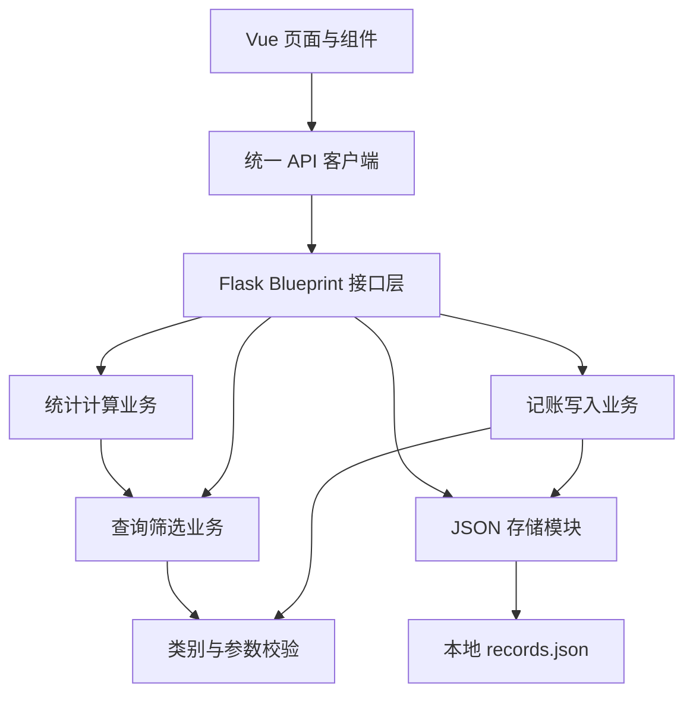

# 个人记账本：项目设计与团队协作规范

> 文档说明：本文件由原仓库 README 迁移，继续作为技术与协作契约；仓库根 README 仅介绍软件。
> 项目形式：本地运行的 Web 记账本。
> 团队规模：11 人，每位成员负责一个明确的代码模块，可在课程允许范围内与各自的 agent 协作。
> 文档状态：首版设计与开发约定。下列源代码目录、接口、组件和测试是待实现的规范，不代表已经完成。
> 本次项目目录：`personal_account_book/`。正式协作时使用本次作业专用的新 GitHub 仓库。

## 1. 项目目标与范围

完成“录入收支 → 本地保存 → 查看记录 → 筛选与统计 → 重启后数据仍然存在”的完整流程，并能通过 GitHub Release 下载运行包进行演示。

### 1.1 首版必须实现

| 功能 | 验收要求 |
| --- | --- |
| 新增收入、支出 | 日期、金额、类别、备注可以录入，保存成功有反馈 |
| 本地保存 | 使用 JSON 文件；首次运行自动初始化；重启后数据仍然存在 |
| 最近记录 | 显示最近 10 条，明确区分收入与支出 |
| 明细查询 | 按日期范围、收支类型、类别、金额范围组合筛选 |
| 查看全部记录 | 明细列表支持分页，可以访问最近 10 条以外的数据 |
| 收支统计 | 返回匹配范围内的总收入、总支出、结余、记录条数 |
| 类别汇总 | 返回各类别支出，作为统计展示及图表的数据来源 |
| 用户反馈 | 输入错误、加载、保存中、无记录、请求失败均有明确状态 |
| 发布运行包 | 包含后端、打包好的前端、依赖清单、启动方式和运行说明 |

### 1.2 完成核心功能后可增加

- 类别支出条形图，由统计展示模块负责。
- 记录编辑、删除、数据导出等功能，按第 14 节的扩展方式增加。
- 基础视觉优化和小屏幕适配。

首版不加入登录、多用户、云同步、微服务等功能。维护空间主要通过明确的模块边界、数据契约和验证方式保留，不提前实现所有扩展。

## 2. 技术框架与运行方式

| 层次 | 选型 | 团队统一约定 |
| --- | --- | --- |
| 前端 | Vue 3 + JavaScript | 单文件组件，使用 `<script setup>` |
| 前端工具 | Vite + npm | 提交 `package-lock.json`，其他成员使用 `npm ci` |
| 页面切换 | Vue 本地状态 | 三个页面使用导航切换，首版不引入路由库 |
| HTTP 请求 | 原生 fetch | 只经过 `frontend/src/api/client.js` |
| 样式 | 原生 CSS | 公共变量集中维护，组件样式使用 `scoped` |
| 后端 | Python + Flask | 应用工厂 + Blueprint + 业务函数 |
| 本地存储 | UTF-8 JSON 文件 | 只由存储模块读写 |
| 图表 | HTML/CSS 条形图 | 图表消费后端汇总结果 |
| 后端验证 | pytest | 重点验证金额、存储、筛选、统计 |

Vue 单文件组件用于隔离组件的结构、逻辑与样式；创建方式参考 [Vue 官方快速开始](https://vuejs.org/guide/quick-start.html)。Flask 通过 Blueprint 组织接口模块，参考 [Flask 官方模块化说明](https://flask.palletsprojects.com/en/stable/blueprints/)。

### 2.1 版本管理

- 1 号确认并在运行说明中记录实际验证过的 Python、Flask 版本。
- 7 号根据 Vue/Vite 的兼容要求确认 Node.js、npm 版本，并提交前端依赖锁文件。
- 初始化后固定实际验证过的依赖版本，不由每个成员分别升级到 latest。
- 新增依赖时说明用途、影响的模块和安装步骤，由对应框架负责人整合。
- 首版不额外引入 Pinia、Axios、数据库 ORM 或大型图表库。

### 2.2 开发与交付

开发模式：Vue/Vite 提供前端开发服务，`/api` 请求代理到本地 Flask。代理保留 `/api` 前缀，前端代码不写死后端域名。配置依据见 [Vite 官方代理说明](https://vite.dev/config/server-options.html#server-proxy)。

交付模式：Vue 构建产物放入运行包的 `web/`，Flask 同时提供静态页面和接口。用户只启动一个本地服务，再用浏览器访问 `http://127.0.0.1:5000`。

Release 使用者需要 Python 和后端依赖，不需要 Node.js，也不需要重新构建前端。依赖已经安装且静态资源全部保存在本地时，可以离线演示。

## 3. 软件架构与依赖边界



| 层次 | 应负责 | 边界 |
| --- | --- | --- |
| 页面与组件 | 用户输入、显示、交互状态 | 不直接访问 JSON 文件，不重新定义业务汇总算法 |
| API 客户端 | 请求、参数编码、响应解包、错误转换 | 不负责记账和统计业务 |
| 接口层 | 接收 HTTP 参数、调用业务、返回状态码 | 不直接打开数据文件，不重复实现筛选 |
| 业务层 | 校验后的记账处理、筛选、排序、统计 | 不依赖前端，不导入 Flask 应用实例 |
| 存储层 | 初始化、读取、追加、写入保护 | 不处理 HTTP，不计算统计结果 |

依赖方向保持单向：接口调用业务与存储，统计复用查询中的筛选函数，业务不反向导入路由。

后端使用一个 Flask 应用，不为每个模块各自启动服务。各 Blueprint 由应用工厂统一注册。

## 4. 计划目录结构与文件归属

以下是开发时应形成的结构。当前已建立目录骨架并实现 6 号类别与校验模块；其他模块由各负责人后续完成。已完成内容及整合方式见 [PM 模块交接](PM模块交接.md)。

```text
personal_account_book/
├─ README.md                         软件介绍与项目入口
├─ requirements.txt                  后端运行依赖，1 号整合
├─ requirements-dev.txt              测试依赖，1 号整合
├─ .gitignore                        忽略规则，1 号
├─ backend/
│  ├─ run.py                         启动入口，1 号
│  └─ app/
│     ├─ __init__.py                 create_app 与模块装配，1 号
│     ├─ config.py                   路径与运行配置，1 号
│     ├─ errors.py                   统一异常与错误响应，1 号
│     ├─ storage.py                  JSON 存储，2 号
│     ├─ categories.py               类别定义，6 号
│     ├─ validators.py               参数校验与 RecordFilter，6 号
│     ├─ routes/
│     │  ├─ __init__.py               包初始化，1 号
│     │  ├─ health.py                 健康检查接口，1 号
│     │  ├─ record_write.py           新增接口，3 号
│     │  ├─ record_query.py           查询接口，4 号
│     │  ├─ statistics.py             统计接口，5 号
│     │  └─ categories.py             类别接口，6 号
│     └─ services/
│        ├─ __init__.py               包初始化，1 号
│        ├─ record_write.py           新增业务，3 号
│        ├─ record_query.py           筛选、排序、分页，4 号
│        └─ statistics.py             汇总计算，5 号
├─ frontend/
│  ├─ package.json                   7 号
│  ├─ package-lock.json              7 号
│  ├─ vite.config.js                 7 号
│  ├─ index.html                     7 号
│  └─ src/
│     ├─ main.js                     7 号
│     ├─ App.vue                     导航与刷新协调，7 号
│     ├─ api/client.js               HTTP 请求封装，7 号
│     ├─ styles/base.css             公共样式，7 号
│     ├─ utils/format.js             金额显示等公共格式化，7 号
│     ├─ components/
│     │  ├─ entry/RecordForm.vue      8 号
│     │  ├─ records/RecordTable.vue   9 号
│     │  ├─ records/RecentRecords.vue 9 号
│     │  ├─ filters/FilterPanel.vue   10 号
│     │  └─ statistics/CategoryChart.vue  11 号
│     └─ views/
│        ├─ EntryView.vue            页面组合，7 号
│        ├─ RecordsView.vue          明细页面，10 号
│        └─ StatisticsView.vue       统计页面，11 号
├─ tests/backend/                    对应模块负责人编写有意义的测试
├─ examples/demo_records.json        演示样例，2 号维护、5 号核对统计
├─ data/records.json                 运行时创建，忽略 Git 跟踪
├─ scripts/
│  ├─ setup.bat                      安装本地运行环境，1 号
│  └─ start.bat                      启动交付版，1 号
└─ web/                              前端构建产物，仅打包交付时生成
```

新增代码模块时只增加实际需要的文件。不要为了与目录示意完全一致而创建没有用途的空模块。

## 5. 11 人具体分工与交付标准

姓名、学号、GitHub 用户名在认领时填入，不能用成员编号替代最终作业中的实名分工。

| 编号 | 负责模块 | 必须完成的代码工作 | 模块验收 |
| --- | --- | --- | --- |
| 1 | 后端框架与项目整合 | 应用工厂、配置、路由注册、错误处理、健康检查、静态资源服务、启动脚本与依赖整合 | 按说明可以启动；各接口接通；未知 API 返回 JSON 404；发布模式能打开页面 |
| 2 | 本地存储 | JsonRecordStore、文件初始化与读取、追加写入、锁、临时文件替换、演示样例 | 首次运行可用；重启不丢数据；损坏文件不会被当成空账本覆盖 |
| 3 | 记账写入 | POST 接口、调用校验、生成 UUID 和创建时间、调用存储、返回新增结果 | 有效记录能保存；无效输入不会写入文件；保存失败不会返回成功 |
| 4 | 查询筛选 | 组合筛选、统一排序、分页、匹配总条数、可复用 filter_records | 日期和金额边界正确；多条件按 AND 组合；翻页不会漏用筛选条件 |
| 5 | 统计计算 | 收入、支出、结余、记录条数、类别支出汇总；复用统一筛选 | 与同条件列表一致；统计全部匹配记录；金额计算准确 |
| 6 | 类别与校验 | 类别集合与接口、录入参数校验、筛选参数校验、分页参数校验、RecordFilter | 类别前后一致；非法日期和金额被拒绝；错误定位到字段 |
| 7 | 前端框架与整合 | Vue/Vite 初始化、页面导航、API 客户端、公共格式化与样式、类别加载、刷新协调 | 三页可访问；统一请求和错误处理；新增成功后相关页面刷新 |
| 8 | 记账表单 | 日期、收支类型、金额字符串、动态类别、备注、保存中和错误状态、saved 事件 | 可完成收支录入；连点不会重复提交；失败保留已填写内容 |
| 9 | 记录展示 | 无副作用的通用表格、最近记录请求、加载和空态、收入支出标记 | 最近 10 条正确；明细页可复用表格；备注按文本安全展示 |
| 10 | 筛选与明细 | 可复用筛选面板、查询/重置、分页、总条数、请求状态；复用表格 | 多条件能组合；重新查询回第一页；快速查询时显示最后一次请求的结果 |
| 11 | 统计展示 | 统计卡片、筛选集成、类别汇总展示、可选条形图、刷新与空态 | 使用后端统计结果；筛选后更新；没有支出时不出现无效比例 |

### 5.1 交付责任

每人交付自己的实现、必要的验证结果、模块说明及真实提交记录。组长和框架负责人负责装配，不接管其他成员的模块实现。

每个模块至少说明：公开接口是什么、依赖谁、被谁使用、如何验证、还有哪些限制。代码行数不作为贡献评价的唯一依据。

1 号兼任后端整合与发布协调；7 号兼任前端整合；2、6 号协助数据与边界检查；10 号可兼任博客材料汇总；11 号可兼任演示串联。每个人都提供自己的编程体验和实际问题记录。

## 6. 数据模型与业务规则

### 6.1 持久化格式

`data/records.json` 的根节点是数组，一条记录的格式如下。示例数据只用于说明契约，不代表已运行产生的记录。

```json
[
  {
    "id": "11111111-1111-4111-8111-111111111111",
    "date": "2026-11-07",
    "type": "expense",
    "amount_cents": 2000,
    "category": "餐饮",
    "note": "午餐",
    "created_at": "2026-11-07T06:30:00.000+00:00"
  }
]
```

| 字段 | 类型 | 规则 |
| --- | --- | --- |
| id | string | 后端生成 UUID v4，唯一且不可由前端指定 |
| date | string | 严格 YYYY-MM-DD，必须是真实日期，按用户选择的业务日期保存 |
| type | string | 仅 income 或 expense |
| amount_cents | integer | 单位为分，始终为正整数，排除布尔值 |
| category | string | 属于对应收支类型的合法类别 |
| note | string | 可空，去除两端空白，最长 200 个字符 |
| created_at | string | 后端生成，UTC、带时区的 ISO 8601，统一毫秒精度 |

业务日期不做 UTC 转换。前端“今天”的默认值按浏览器本地年月日生成，避免使用 UTC 日期截取造成跨日。

### 6.2 金额约定

- 创建接口只接受金额字符串，例如 `"20"`、`"20.5"`、`"20.50"`。
- 接受普通十进制形式，最多两位小数，范围为 0.01～99,999,999.99 元。
- 拒绝 JSON 数值、负数、零、科学计数法、货币符号、千分位、NaN、Infinity 和超过两位的小数。
- 不自动四舍五入用户输入；不合法时返回字段错误。
- 后端从字符串使用 Decimal 校验并精确转为整数分；存储、筛选与求和均用整数分。
- 响应中的金额统一使用以 `_cents` 结尾的整数；结余可以为负数。
- 前端仅将整数分格式化成两位小数展示；图表可以计算展示比例。

Decimal 的十进制处理能力参见 [Python 官方说明](https://docs.python.org/3/library/decimal.html)。

### 6.3 固定类别

收入类别：`工资`、`奖金`、`兼职`、`理财`、`其他收入`。

支出类别：`餐饮`、`交通`、`购物`、`住房`、`医疗`、`娱乐`、`学习`、`其他支出`。

类别只在后端 `categories.py` 定义，前端通过接口获取。首版不实现自定义类别管理。

### 6.4 筛选、排序与统计口径

- 各筛选条件按 AND 组合，空条件不参与筛选。
- 日期起止都包含；金额上下限都包含，针对单笔金额。
- 查询金额边界允许为零，最大值与录入金额上限相同。
- 开始日期晚于结束日期、最低金额高于最高金额，返回 400。
- 未指定 type 时可以查询任意合法类别；指定 type 后类别必须与之匹配。
- 记录按 date、created_at、id 依次倒序，第三个字段用于稳定排序。
- 最近记录使用相同排序，显式设置 limit=10；不等同于“最后录入的十条”。
- 结余 = 当前匹配范围收入 - 当前匹配范围支出，不是银行账户余额。
- 只筛选支出时，收入应为 0，结余可以为负数。
- 类别图表只展示匹配范围的支出。类别金额按降序排列，同金额按类别名称排序。
- 没有匹配记录时返回空列表与零值，不能返回缺失字段或报错。

## 7. HTTP 接口规范

### 7.1 通用规则

接口前缀为 `/api`，请求和响应使用 JSON，字段统一 snake_case。需要中文查询参数时由 URLSearchParams 编码，不自行拼接查询字符串。

成功响应：

```json
{
  "data": {}
}
```

错误响应：

```json
{
  "error": {
    "code": "VALIDATION_ERROR",
    "message": "输入参数不合法",
    "fields": {
      "amount": "金额最多保留两位小数"
    }
  }
}
```

`fields` 无字段错误时返回空对象。HTTP 状态码用于区分结果，不能所有情况都返回 200 再让前端猜测。

| 状态码 | code 示例 | 含义 |
| --- | --- | --- |
| 200 | 不适用 | 查询成功 |
| 201 | 不适用 | 新增成功且已经持久化 |
| 400 | VALIDATION_ERROR / INVALID_JSON | 参数不合法、JSON 无法解析、未知参数 |
| 404 | NOT_FOUND | 接口或资源不存在 |
| 405 | METHOD_NOT_ALLOWED | HTTP 方法不支持 |
| 415 | UNSUPPORTED_MEDIA_TYPE | 创建接口未使用 JSON Content-Type |
| 500 | STORAGE_ERROR / INTERNAL_ERROR | 存储故障或其他服务错误 |

错误详情记录在后端，响应提供用户能理解的信息；文件绝对路径、堆栈和调试页面不返回到交付版界面。

### 7.2 接口总表

| 方法 | 路径 | 负责人 | 用途 |
| --- | --- | --- | --- |
| GET | /api/health | 1 | 服务存活检查 |
| GET | /api/categories | 6 | 获取收入和支出类别 |
| POST | /api/records | 3 | 新增记录 |
| GET | /api/records | 4 | 查询、排序和分页 |
| GET | /api/statistics | 5 | 获取全部匹配记录的统计 |

### 7.3 健康检查

`GET /api/health` 返回 200：

```json
{
  "data": {
    "status": "ok"
  }
}
```

该接口表示服务可响应，不替代存储和业务验收。

### 7.4 获取类别

`GET /api/categories` 返回 200：

```json
{
  "data": {
    "income": ["工资", "奖金", "兼职", "理财", "其他收入"],
    "expense": ["餐饮", "交通", "购物", "住房", "医疗", "娱乐", "学习", "其他支出"]
  }
}
```

### 7.5 新增记录

`POST /api/records`，请求头包含 `Content-Type: application/json`。

```json
{
  "date": "2026-11-07",
  "type": "expense",
  "amount": "20.00",
  "category": "餐饮",
  "note": "午餐"
}
```

前四项必填，note 省略时默认为空字符串。请求体必须是对象；未知字段返回 400，前端不能提交 id、amount_cents、created_at。

持久化成功后返回 201：

```json
{
  "data": {
    "id": "11111111-1111-4111-8111-111111111111",
    "date": "2026-11-07",
    "type": "expense",
    "amount_cents": 2000,
    "category": "餐饮",
    "note": "午餐",
    "created_at": "2026-11-07T06:30:00.000+00:00"
  }
}
```

### 7.6 查询记录

`GET /api/records` 支持以下参数：

| 参数 | 类型 | 规则 |
| --- | --- | --- |
| start_date | YYYY-MM-DD 字符串 | 可选，包含当天 |
| end_date | YYYY-MM-DD 字符串 | 可选，包含当天 |
| type | 字符串 | 可选，income 或 expense |
| category | 字符串 | 可选，合法类别 |
| min_amount | 金额字符串 | 可选，含边界、允许零 |
| max_amount | 金额字符串 | 可选，含边界、允许零 |
| limit | 整数字符串 | 默认 20，范围 1～100 |
| offset | 整数字符串 | 默认 0，必须大于等于 0 |

空字符串视为未填写。其他非法值或未知参数返回 400，不自动交换边界、不偷偷改成默认值。

示例：`/api/records?type=expense&min_amount=10.00&max_amount=100.00&limit=20&offset=0`。

以下为只有一条匹配记录时的响应：

```json
{
  "data": {
    "items": [
      {
        "id": "11111111-1111-4111-8111-111111111111",
        "date": "2026-11-07",
        "type": "expense",
        "amount_cents": 2000,
        "category": "餐饮",
        "note": "午餐",
        "created_at": "2026-11-07T06:30:00.000+00:00"
      }
    ],
    "total": 1,
    "limit": 20,
    "offset": 0
  }
}
```

`total` 是分页前的匹配总条数。offset 超过匹配范围时，items 为空，total 仍为真实匹配条数。

### 7.7 收支统计

`GET /api/statistics` 接受与记录查询完全一致的六个业务筛选参数，不接受 limit、offset。它针对全部匹配记录统计。

假设匹配数据为工资收入 1000 元、餐饮支出 20 元、交通支出 5 元，返回：

```json
{
  "data": {
    "income_cents": 100000,
    "expense_cents": 2500,
    "balance_cents": 97500,
    "count": 3,
    "income_count": 1,
    "expense_count": 2,
    "expense_by_category": [
      {"category": "餐饮", "amount_cents": 2000, "count": 1},
      {"category": "交通", "amount_cents": 500, "count": 1}
    ]
  }
}
```

没有匹配记录时，上述数值全部为 0，expense_by_category 为 `[]`。只返回实际有匹配支出的类别。

## 8. 后端内部接口与实现边界

本节是函数签名与行为约定，不是已经实现的代码。负责人可以编写私有辅助函数，但公开签名变更要同步消费者和本文。

### 8.1 应用装配：1 号

- `create_app(test_config=None) -> Flask`：创建应用、加载配置、创建存储实例、注册 Blueprint 与错误处理。
- 存储实例放在 `app.extensions["record_store"]`，路由通过 current_app 获取；业务模块不导入 app 实例。
- 测试通过配置传入临时数据路径，不使用真实账本。
- DATA_FILE 默认定位到项目根目录下的 `data/records.json`，不依赖启动终端当前目录。
- WEB_DIST_DIR 发布时指向 `web/`；开发构建检查可以显式指向 `frontend/dist/`。
- 交付版监听本机回环地址，关闭 debug 和自动重载，按单进程运行。
- 首页和静态资源正常提供；未知 `/api/...` 返回 JSON 404，不能被首页兜底覆盖。
- 本地启动脚本先定位项目根目录，检查环境与构建产物，失败时给出可操作的提示。

Blueprint 名称统一为 `health_bp`、`categories_bp`、`record_write_bp`、`record_query_bp`、`statistics_bp`；由对应 routes 文件导出。

### 8.2 存储：2 号

```text
JsonRecordStore(file_path)
    initialize() -> None
    list_records() -> list[dict]
    append_record(record: dict) -> dict
```

- 应用中创建一个存储实例；实例持有路径与线程锁。
- initialize 在文件不存在时创建目录和空数组；存在时校验基础结构，不覆盖原内容。
- list_records 返回重新读取的记录，不向外暴露共享可变缓存。
- append_record 对“读取—追加—写回”的整个过程加锁，不只是锁最终写入。
- 读取与写入共用同一个锁，按本次单进程运行方式保证一致性。
- 临时文件放在数据文件的同一目录，完整写入并关闭后再使用 os.replace 替换。
- 文件根节点错误、记录缺少必要字段、id 重复、金额类型错误等情况视为损坏；保留原文件并报错，不返回假空数组。
- 首版不提供随意覆盖全部记录的公共 save_all 接口，防止业务模块绕过更新约束。

文件替换行为参考 [Python os.replace 文档](https://docs.python.org/3/library/os.html#os.replace)。本设计针对本地单进程；以后改为多进程或多用户时必须重新评估并发存储方案。

### 8.3 类别与校验：6 号

```text
get_categories() -> dict
validate_record_payload(payload: dict) -> dict
parse_filters(params) -> RecordFilter
parse_pagination(params) -> tuple[int, int]
```

`validate_record_payload` 返回规范化的 date、type、amount_cents、category、note，不生成 id 或 created_at。

`RecordFilter` 统一包含 start_date、end_date、type、category、min_amount_cents、max_amount_cents；未填写项为 None。日期内部可以使用 date 对象，金额为整数分。

校验失败抛出 errors.py 中约定的 ValidationError，包含 message 和字段错误。未知参数由对应路由按接口白名单拒绝；parse_filters 只解析六个业务筛选项。

### 8.4 写入业务：3 号

```text
create_record(payload: dict, store: JsonRecordStore) -> dict
```

处理顺序：校验 → 生成 UUID 和 UTC 创建时间 → 组装记录 → 持久化 → 返回记录。任何失败都不能提前返回成功或保留部分写入。

### 8.5 查询业务：4 号

```text
filter_records(records: list[dict], filters: RecordFilter) -> list[dict]
query_records(records, filters, *, limit: int, offset: int) -> dict
```

filter_records 是无文件读写、无 Flask 依赖的纯函数，不修改输入，也不分页。query_records 复用它后执行稳定排序、计算 total、切片，返回 items、total、limit、offset。

查询路由读取一次存储，解析参数后调用业务函数。统计模块可以只调用 filter_records，避免复用带分页的 HTTP 接口。

### 8.6 统计业务：5 号

```text
summarize_records(records: list[dict], filters: RecordFilter) -> dict
```

调用 filter_records 后只使用整数分进行计算，返回第 7 节定义的字段。输入来自一次读取快照，不在一次统计中反复读取文件。

## 9. 前端组件与通信约定

### 9.1 页面组成

```text
App.vue                             7 号
├─ EntryView.vue                    7 号：只组合，不代写子组件
│  ├─ RecordForm.vue                8 号
│  └─ RecentRecords.vue             9 号
│     └─ RecordTable.vue            9 号
├─ RecordsView.vue                  10 号
│  ├─ FilterPanel.vue               10 号
│  └─ RecordTable.vue               复用 9 号组件
└─ StatisticsView.vue               11 号
   ├─ FilterPanel.vue               复用 10 号组件
   └─ CategoryChart.vue             11 号，可选图表
```

App 使用本地状态切换三个页面，首版采用 v-if 挂载当前页；重新进入页面时重新请求，筛选默认重置。需要保留筛选状态时，应明确作为后续交互变更。

### 9.2 Props 与事件

| 组件 | Props | 事件与职责 |
| --- | --- | --- |
| RecordForm | categories | 保存成功发出 `saved(record)`；失败保留表单 |
| RecordTable | records | 仅显示传入数据，不发请求、不改变父组件数据 |
| RecentRecords | refreshKey | 挂载及 refreshKey 改变时请求 limit=10 |
| FilterPanel | categories、loading | `search(filters)`、`reset()`；管理内部草稿 |
| RecordsView | categories、refreshKey | 接收筛选，管理 appliedFilters、分页和结果 |
| StatisticsView | categories、refreshKey | 接收筛选并请求统计，向图表传递汇总 |
| CategoryChart | items、totalCents | 只显示类别金额与比例；totalCents=0 时显示空态 |
| EntryView | categories、refreshKey | 将 RecordForm 的 saved 事件向 App 传递 |

categories 的形状与 GET /api/categories 的 data 一致。

FilterPanel 发出的 filters 使用 HTTP 参数名，金额保留字符串，空项可以省略。仅点击查询或重置时触发请求，编辑输入时不自动发送。用户更改 type 后，若原类别不属于新类型，应清空类别。

### 9.3 刷新流程

1. 8 号调用 createRecord，服务端持久化成功后发出 saved。
2. EntryView 向 App 转发事件，7 号增加 refreshKey。
3. 当前最近记录组件监听 refreshKey 并重新请求。
4. 明细与统计页进入时读取最新数据；已挂载页面收到刷新标记时重新请求。
5. 失败不发出 saved，不增加刷新标记。

不要通过 location.reload 刷新整个网站，也不要让子组件直接调用另一个页面的内部方法。

### 9.4 API 客户端：7 号

```text
getCategories() -> Promise<Categories>
createRecord(payload) -> Promise<Record>
listRecords(params = {}) -> Promise<RecordPage>
getStatistics(filters = {}) -> Promise<Statistics>
```

- 统一以 `/api` 为前缀，封装 fetch、JSON 请求头、查询参数编码。
- 成功时只返回响应中的 data，页面不再手动访问第二层 data。
- 失败抛出统一 ApiError，包含 code、message、fields；网络故障使用 NETWORK_ERROR。
- 空查询项不发送，数值零不能被错误忽略。
- listRecords 可以传 limit、offset；getStatistics 只发送六个业务条件。
- 不自动重试 POST，避免网络状态不确定时重复新增。
- formatMoney(cents) 集中维护，返回两位小数金额字符串，符号和颜色由界面决定。

### 9.5 页面状态

- loading、error、empty、success 分开表达，不能把请求失败显示成“暂无数据”。
- 保存期间禁用保存按钮；前端防重复点击不替代后端校验。
- 快速查询、翻页时，使用请求序号或取消机制，保证最后发起的请求决定界面结果。
- 列表与图表使用稳定的 key，分别使用记录 id 和类别名称。
- 备注使用 Vue 文本插值展示，不使用 v-html。
- 类别加载失败时提供重试提示，录入表单不能用前端写死的备用类别提交。

## 10. 代码编写规则

### 10.1 通用规则

1. 只实现本人模块及明确约定的交付内容，修改其他模块前先协调其负责人。
2. 一份业务规则只保留一个来源：类别、金额校验、筛选、统计不能各写多份。
3. 保持函数职责清楚，避免将文件读写、HTTP 解析和统计逻辑塞进同一个函数。
4. 公共函数、组件和接口变更同步更新本文，调用方同步适配。
5. 不通过捕获所有异常并返回空数据来“修复”错误；不能返回假成功。
6. 不提交调试输出、真实账本、密钥、虚拟环境、依赖目录和无关文件。
7. 注释解释规则和原因，例如金额为何使用分；不逐行复述代码。
8. 不为假设性的未来需求加入通用插件框架、复杂继承、额外服务等结构。

### 10.2 Python

- 4 空格缩进；模块和函数 snake_case，类 PascalCase，常量 UPPER_SNAKE_CASE。
- 公共函数标明参数和返回类型，业务函数写简短说明。
- 路由保持薄层，核心计算放 services 中，校验放 validators 中。
- 路径使用 pathlib，并根据项目位置或显式配置解析，不能写个人电脑绝对路径。
- 资源使用上下文管理器关闭；写入异常由统一错误处理转换。
- 使用标准 logging 记录必要错误，不把金额或筛选逻辑埋在日志处理里。
- 时间生成统一带时区，业务 date 保留日期字符串语义。

### 10.3 Vue / JavaScript / CSS

- Vue 文件 PascalCase；变量、函数 camelCase；常量 UPPER_SNAKE_CASE。
- 使用 `<script setup>`，不在同一项目混用多种组件组织风格。
- Props 只读；更新通过事件或本组件状态完成，不直接修改 Props 对象。
- 组件负责自己的 loading 与错误状态，公共请求逻辑保持集中。
- 组件 CSS 使用 scoped；颜色、间距等公共变量由 7 号维护。
- 不使用行内拼接 HTML 展示用户输入；按钮、输入框有清楚文字与标签。
- 涉及人民币输入时保留字符串，不能用 parseFloat 后直接乘 100 作为最终业务金额。
- package.json、锁文件、Vite 配置的变更由 7 号整合，避免依赖冲突。

## 11. 项目规则与变更管理

### 11.1 公共文件负责人

| 文件或约定 | 协调人 | 修改规则 |
| --- | --- | --- |
| 本文、API 契约、后端启动与依赖 | 1 号 | 涉及消费者的变更要同步相关负责人 |
| JSON 格式与存储接口 | 2 号 | 兼容已有数据，迁移前明确备份与验证 |
| 类别、金额和筛选参数校验 | 6 号 | 同步写入、查询、统计和前端 |
| 前端入口、公共请求、依赖与样式 | 7 号 | 各页面不自行修改全局约定 |

常规实现由负责人自主决定；接口、文件归属或数据格式的变更先在 Issue/PR 中写清影响，再由相关负责人确认。无需让全组逐一审批不相关的内部修改。

### 11.2 数据与忽略规则

应忽略：`.venv/`、`node_modules/`、`__pycache__/`、`.pytest_cache/`、本地日志、`.env`、`data/`、`frontend/dist/`、`web/`、本地构建输出。

应提交：源代码、依赖清单、package-lock.json、运行说明、脱敏样例数据、必要测试。示例数据放 examples，不能依赖每个人都拥有同一份运行时账本。

启动、升级和导入操作不能静默清空真实数据。测试只能使用临时目录。需要覆盖或迁移已有账本时，先给出明确操作说明、备份与恢复方式。

### 11.3 合并与完成标准

“模块完成”表示实现、接口接通、关键验证通过、说明与真实提交齐全。仅能在个人分支运行，或只写静态假数据页面，都不算完成联调。

main 保存已整合且可运行的版本。未完成模块可以通过 Draft PR 展示进展，但不能使用返回假成功的实现来伪装完成。

## 12. GitHub 协作方法

### 12.1 仓库与分支

- 1 号新建本次作业专用仓库，添加全部成员，确认助教能够访问。
- 每个模块创建对应 Issue，包含负责人、文件边界、接口依赖和验收条件。
- 1、7 号先合入最小后端与前端骨架，其他成员基于同一个 main 开始。
- 分支采用 `feat/03-record-write`、`feat/09-record-table` 等形式；修复使用 `fix/...`。
- 使用本人账号和真实 Git 身份，不伪造 author、不拆分他人实现冒充个人贡献。

### 12.2 日常流程

```text
认领 Issue
→ 获取 main 最新内容
→ 建立自己的功能分支
→ 与自己的 agent 完成模块
→ 自测并记录结果
→ 提交代码与 PR
→ 另一名成员检查
→ 修复问题
→ 合并 main
→ 检查整合结果
```

已经克隆仓库后的命令示意：

```powershell
git switch main
git pull --ff-only origin main
git switch -c feat/03-record-write
```

有未提交修改时先妥善保存本人的工作，不通过 hard reset 或强制覆盖清理。首次克隆地址使用本次新仓库的真实 URL。

开发分支同步主分支：

```powershell
git fetch origin
git merge origin/main
```

提交前检查范围：

```powershell
git status
git diff
```

选择具体文件暂存，避免无检查地加入整个工作区。提交示例：`feat(records): 完成新增记录接口与校验接入`。

### 12.3 PR 与复审

PR 至少包含以下内容：

```markdown
关联 Issue：#编号
负责模块：
实现内容：
公开接口/数据结构是否变化：
验证方法与实际结果：
界面截图（涉及界面时）：
已知限制：
```

每个 PR 由至少另一位成员阅读，检查职责边界、契约、金额处理和实际结果。前端 PR 附可观察的界面，后端 PR 附请求与响应或测试结果。

推荐使用 Create a merge commit 保留分支提交；不要通过集中代提或改写身份制造贡献记录。冲突由改动相关成员协调解决，整合人不能直接覆盖其他成员的实现。

GitHub PR 的协作机制参见 [官方说明](https://docs.github.com/en/pull-requests/reference/pull-requests)。

## 13. 与各自 agent 协作的规则

每位成员为自己的模块负责：明确目标、审查修改、理解实现、运行验证，并能在演示时解释。原作业禁止代写和伪造提交；AI 辅助的允许范围以课程规定为准，不把未审查或无法解释的产出当作本人已完成的工作。

给 agent 的任务统一提供本文、本人模块和文件边界。不同成员的 agent 使用各自本地克隆或独立工作目录，避免同时写同一份共享工作区。

可直接复制并填写以下任务模板：

```text
你正在参与“轻账本”团队项目。先阅读仓库 README.md。

我的成员编号与模块：
允许修改的文件：
需要实现的公开函数/组件：
依赖的接口与样例：
验收条件：

执行要求：
1. 遵守 README 中的数据、API、组件和代码规则。
2. 先检查当前代码与未提交修改，保留其他成员的工作。
3. 优先完成本模块的最小完整实现，只修改约定范围。
4. 遇到依赖未完成时，使用隔离的样例进行本模块验证，交付前接回真实接口。
5. 公共契约有问题时，说明影响并与相关负责人协调，避免自行改变。
6. 修改后完成与本模块相关的验证，不虚构测试结果。
7. 输出修改文件、实现内容、验证结果、限制和需要配合的事项。
```

最终演示路径必须使用真实保存、真实查询和真实统计。开发样例只用于独立调试，不能作为假后端留在发布版中。

## 14. 维护、扩展与老师追问准备

### 14.1 维护空间放在哪里

| 扩展点 | 当前应有的边界 | 带来的维护能力 |
| --- | --- | --- |
| 数据访问 | 业务通过 JsonRecordStore 访问数据 | 更换存储时能定位影响范围 |
| 筛选规则 | filter_records 为独立纯函数 | 新增筛选后列表与统计能保持一致 |
| 参数校验 | validators 统一处理 | 修改规则不会散落多个接口 |
| 类别来源 | 后端类别接口 | 新增固定类别不需要改多个下拉框 |
| 前后端契约 | 统一响应和 API 客户端 | 地址、错误处理、返回结构集中适配 |
| 记录展示 | RecordTable 只接收数据 | 最近记录、明细、后续搜索可复用 |
| 筛选展示 | FilterPanel 发出条件 | 明细与统计共用相同交互 |
| 统计展示 | 后端汇总与图表分离 | 新图表可以消费既有统计结果 |
| 配置 | 数据路径与静态资源路径集中 | 开发、测试与交付使用不同路径 |

这些是实现时的验收点。讲解时应打开实际代码证明，不把本设计中尚未完成的能力描述成已经具备。

### 14.2 新增或修改功能的统一步骤

1. 写清用户操作和期望结果，例如“修改一条记录后，列表与统计都更新”。
2. 判断是否涉及数据字段、API、校验、存储、界面或旧数据。
3. 确定负责人和消费者；公共变化先更新契约。
4. 先调整业务与存储，再接接口与界面；内部改动可独立完成。
5. 对变化部分增加有意义的验证，并复查记账、查询、统计主流程。
6. 涉及旧数据时先备份，以副本验证迁移与恢复，不自动覆盖正式账本。
7. 通过 PR 合并，更新运行说明和版本记录。

### 14.3 具体扩展示例

| 老师提出的需求 | 需要修改的模块 | 应如何实现与验证 |
| --- | --- | --- |
| 新增一个固定类别“宠物” | 6 号类别与校验 | 在类别来源增加选项；前端通过接口自动取得；验证新类别可保存、筛选、统计 |
| 增加备注关键字查询 | 6 号解析、4 号筛选、10 号面板、7 号参数传递 | 增加 keyword 契约与长度规则，filter_records 做文本匹配；统计如支持同条件，11 号复用面板；验证中文、空值和组合条件 |
| 修改一条记账记录 | 2 号存储、3 号写入业务、6 号校验、8/9 号操作界面 | 增加按 id 更新的原子操作和 PATCH 接口；保留 id、created_at；校验后保存；刷新列表与统计；验证不存在的 id 和失败不改变原记录 |
| 删除一条错误记录 | 2、3、9 号 | 增加按 id 删除与 DELETE 接口、确认交互；保留其他记录；验证删除后统计变化及不存在 id 的处理 |
| 显示每日收支趋势 | 5 号统计、11 号展示 | 对匹配记录按业务 date 分组，新增明确的响应字段或独立接口；图表只消费结果；验证跨月、空日期和收支混合 |
| 导出当前筛选结果 | 4 号查询与新导出处理、10 号按钮 | 复用 filter_records 导出全部匹配记录，不只导出当前页；CSV 处理中文、引号、逗号、换行和电子表格公式前缀 |
| 将 JSON 换成 SQLite | 2 号存储实现、1 号装配 | 新增满足现有方法契约的 SQLite 存储并替换装配点；设计导入迁移；复跑存储与业务验证；大数据查询下再评估下推筛选 |
| 新增支付方式字段 | 6 号模型校验、2 号旧数据处理、3 号保存、8/9 号表单表格 | 先约定可选值和旧记录默认值；兼容缺字段的旧文件；同步响应与必要筛选；用新旧数据混合验证 |
| 调整颜色和布局 | 7 号公共样式、对应组件负责人 | 修改样式变量与组件布局，不改变金额、筛选或存储逻辑 |

以上是后续实现方案，不是首版同时开发的功能清单。新增支付方式等字段时保留旧接口输入的兼容默认值；涉及不兼容变化才评估新 API 版本。

### 14.4 旧数据兼容规则

- 首版 JSON 根节点维持数组，不提前加入复杂版本管理。
- 新增可选字段时定义旧记录默认值，在读取或迁移边界统一补齐，避免每个组件猜测。
- 删除、改名、改变字段含义或金额单位都属于高影响变更，要提供明确迁移方案。
- 不把现有 amount_cents 改回浮点元；新接口继续明确单位。
- 真正需要破坏性迁移时，再引入 schema 版本或迁移标记，先生成备份并验证恢复。
- 数据损坏和旧版本格式不同是两种情况，不能都处理成空账本。

### 14.5 可用于讲解的问题与依据

| 问题 | 应展示的实际依据 |
| --- | --- |
| 为什么金额不使用 float？ | amount_cents、Decimal 转换以及 0.10 + 0.20 的验证结果 |
| 为什么查出来的记录与统计一致？ | 列表和统计共同调用 filter_records，统计不分页 |
| 如何避免新增时把文件写坏？ | 完整读改写加锁、同目录临时文件替换、错误保留原文件 |
| 新增功能一般从哪里改？ | 上述扩展表，以及 routes/services/storage/组件的职责边界 |
| 换数据库是否只改一行？ | 说明需要新存储实现、装配、迁移与验证；当前抽象用于控制影响，不承诺零改动 |
| 谁负责哪个模块？ | 实名分工表、文件、PR、真实提交和本人讲解 |
| 断网还能演示吗？ | 演示机依赖已安装，前端资源本地化，JSON 本地保存 |
| 多个人同时在线使用可以吗？ | 当前定位单机单用户单进程；多用户需要身份、隔离及并发方案 |

## 15. 验证与验收

### 15.1 重点自动验证

按模块编写有意义的测试，避免只验证包装函数是否被调用。

| 负责人 | 重点验证 |
| --- | --- |
| 2 | 空文件初始化、追加与重读、损坏文件保留、写入失败后原数据仍可读、同进程并发追加 |
| 3、6 | 日期、金额字符串、类别匹配、缺少字段、未知字段、保存失败不返回成功 |
| 4 | 日期和金额含边界、多条件组合、稳定排序、分页 total、超范围 offset |
| 5 | 整数金额求和、负结余、无匹配记录、类别汇总总额、统计不受分页影响 |
| 1 | 统一错误响应、未知 API 的 404、独立数据路径与交付静态页面 |

前端以页面交互验收为主，首版不为简单组件额外引入完整端到端测试框架。涉及复杂竞态或新状态逻辑时，再增加对应自动验证。

### 15.2 统一演示数据与预期

同一天建立以下三条样例：

| 类型 | 类别 | 金额 |
| --- | --- | --- |
| 收入 | 工资 | 1000.00 |
| 支出 | 餐饮 | 20.00 |
| 支出 | 交通 | 5.00 |

应观察到：收入 1000.00、支出 25.00、结余 975.00、记录数 3。筛选餐饮后收入为 0、支出为 20.00、结余为 -20.00、记录数 1。

另外在隔离测试账本中加入 0.10 与 0.20 元支出，合计必须为 0.30 元。不要把精度检查数据混入上面的三条基准后仍沿用原预期。

### 15.3 全流程人工验收

- 新增收入与支出后，最近记录更新；金额、日期和类别显示正确。
- 保存期间连续点击只发送一次请求；失败保留输入并说明原因。
- 筛选能组合，重置恢复默认；超过一页的数据可翻页。
- 修改筛选后回到第一页，快速查询不会被旧响应覆盖。
- 统计与同条件记录一致，类别汇总之和等于总支出。
- 空账本、无匹配结果、只有收入、只有支出都能展示。
- 非法输入不会写入；服务不可用时显示错误而不是假空态。
- 重启后数据仍在；数据损坏时保留文件并提示处理。
- 另一位成员从源码和 Release 分别按说明运行，并记录真实结果。

没有实际执行的测试不得标记为通过。个人模块通过不等于整合版已经通过。

## 16. Release、运行说明与展示交付

### 16.1 Release 的含义

Web 项目可以发布 GitHub Release，附件可以是可运行 ZIP；不要求必须提供 APK 或 EXE。发布流程参考 [GitHub 官方说明](https://docs.github.com/en/repositories/releasing-projects-on-github/managing-releases-in-a-repository)。

源代码自动归档与交付运行包是两件事：源码归档包含前端源文件；运行包必须另外带上已经构建好的 web 静态资源。

### 16.2 建议运行包

```text
qing-ledger-v1.0.0-windows/
├─ backend/
├─ web/                         从 frontend/dist 复制的完整构建产物
├─ examples/demo_records.json
├─ scripts/setup.bat
├─ scripts/start.bat
├─ requirements.txt
└─ README.md                    实际安装、启动与操作说明
```

运行包不包含 .venv、node_modules 或真实账本。首次运行创建自己的 data 目录。样例只通过明确的演示初始化方式使用，不在每次启动时覆盖用户数据。

setup.bat 使用项目内虚拟环境安装固定依赖，不更改全局 Python 环境。start.bat 检查环境与构建产物后启动应用，不自行升级依赖或清空账本。运行脚本从任意终端目录调用时都应定位到项目目录。

Release README 必须明确：需要的 Python 版本、安装依赖是否需要联网、具体命令或脚本、访问地址、数据位置、备份方法、已知限制。断网演示前先完成依赖安装；运行包不等于无需安装环境的独立 EXE。

### 16.3 发布检查

- 标签对应已经验收的提交，Release 说明包含版本、功能、运行方法和已知限制。
- 前端构建产物与同一版本后端匹配；不使用任意本地残留 dist。
- 从实际上传的附件下载并解压验证，不能只验证开发目录。
- 验证静态资源均本地可用，不依赖 CDN 字体、脚本或图片。
- 使用其他成员电脑或干净目录核查启动方式与数据保存。
- 仓库、Release、团队博客、图片和视频链接对助教可访问。

### 16.4 每人需要保留的交付材料

本人模块说明、关键代码说明、实际验证、PR/commit 链接、必要截图、个人体验，以及真实发生的问题和解决记录。博客整理人汇总这些材料，不编造讨论事件和编程体验。

作业所需课程链接、作业链接、团队名称、11 人姓名学号、职责、运行环境、截图视频、关键代码、亮点、至少三项真实收获事件、个人体验、仓库与提交记录，在提交博客前逐项补齐。

## 17. 开工前共同确认的内容

- [ ] 11 个编号已对应姓名、学号、GitHub 账号和模块。
- [ ] 本次新仓库已建立，全部成员具备所需访问权限。
- [ ] 1、7 号确认并记录后端与前端实际工具版本。
- [ ] 全员及各自 agent 使用同一份本文与同一版 API 契约。
- [ ] 金额单位、类别、筛选口径、分页和组件事件已一致。
- [ ] 公共文件负责人明确，个人分支与修改范围明确。
- [ ] 首版范围明确，扩展表中的功能不会被默认当成全部必做。

项目完成以实际代码、实际运行和真实协作为依据。本文随着已确认的契约变更更新，保留足够解释实现与维护方式的信息。
